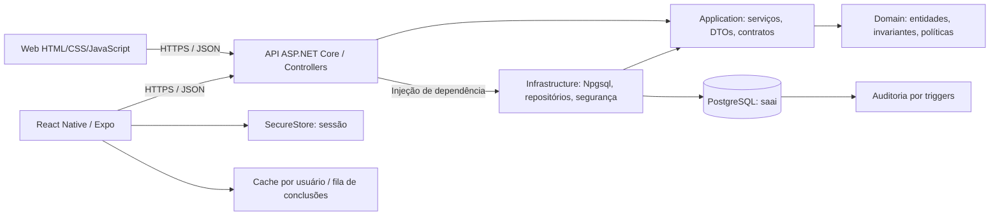

# Arquitetura da EducaTech SAAI

O sistema dá continuidade à empresa fictícia EducaTech Solutions, do segmento EdTech, e ao SAAI do PIM III. A implementação transforma os fluxos simulados do HTML em operações persistidas: quatro perfis, catálogo, matrículas, conteúdo, questões, avaliação automática, progresso e gestão de usuários.

## Organização e decisões



As setas de dependência do código apontam para dentro: Domain não conhece ASP.NET, Npgsql ou clientes. Application conhece somente Domain; Infrastructure implementa os contratos de Application; API é a raiz de composição. Web e Mobile consomem o mesmo contrato `/api/v1`.

| Camada         | Arquivos principais                                                                           | Responsabilidade                                                     |
| -------------- | --------------------------------------------------------------------------------------------- | -------------------------------------------------------------------- |
| Domain         | `backend/EducaTech.Domain/Entities.cs`                                                        | `User`, `Course`, validação e política de avaliação                  |
| Application    | `Contracts.cs`, `Services.cs`, `AcademicContracts.cs`, `AcademicService.cs`                   | Casos de uso, perfil, regras acadêmicas e interfaces de persistência |
| Infrastructure | `LearningRepository.cs`, `AcademicRepository.cs`, `UserRepository.cs`, `SessionRepository.cs` | SQL parametrizado, transações e mapeamento explícito                 |
| Infrastructure | `Security.cs`                                                                                 | Hash de senha e emissão de JWT/refresh token                         |
| API            | `Controllers/`, `Program.cs`, `ErrorMiddleware.cs`                                            | HTTP, autenticação, autorização, limites, Problem Details e OpenAPI  |
| Web            | `frontend/app.js`, `academic.js`, `api.js`, `original-theme.css`                              | Rotas, interface original adaptada, gestão e consumo da API          |
| Mobile         | `mobile/App.tsx`, `src/api.ts`, `src/storage.ts`                                              | Navegação, armazenamento seguro, cache e sincronização               |

O monólito modular reduz custo operacional para a organização acadêmica. Não há necessidade demonstrada de microsserviços. Os contratos permitem separar módulos posteriormente sem alterar os clientes. Repositórios específicos expressam as operações necessárias e evitam um repositório genérico com consultas ilimitadas.

## Pilares da orientação a objetos

- **Encapsulamento:** `User` e `Course` possuem propriedades com alterações privadas. Construtores e `Guard` impedem objetos com dados obrigatórios inválidos. A senha em texto não é uma propriedade persistida.
- **Herança:** `User` e `Course` especializam `Entity`; `PercentageGradingPolicy` especializa `GradingPolicy`.
- **Abstração:** interfaces de repositórios, `IPasswordService`, `ITokenService` e a política abstrata isolam os detalhes da infraestrutura.
- **Polimorfismo:** `LearningService` recebe `GradingPolicy`, utilizando `IsPassing` sem conhecer a classe concreta. Os serviços também utilizam repositórios por interface, selecionados pelo contêiner de DI.

`PercentageGradingPolicy` considera aprovação a partir de 70/100, premissa técnica configurada em código para a demonstração, não uma média institucional fornecida pelo manual. A correção efetiva ocorre na procedure SQL. `Calculate` explicita a fórmula do domínio e `IsPassing` classifica os resultados entregues pelo serviço. Os perfis são papéis de autorização, não subclasses artificiais de usuário: uma mesma pessoa pode mudar de papel sem trocar sua identidade.

## Fluxo de avaliação

```mermaid
sequenceDiagram
  participant C as Web / Mobile
  participant A as Controller
  participant S as LearningService
  participant R as LearningRepository
  participant D as PostgreSQL
  C->>A: GET /assessments/{id} + JWT
  A->>D: Confere usuário ativo e versão da sessão
  A->>R: Busca somente questões e alternativas, sem gabarito
  R-->>C: AssessmentDto
  C->>A: POST /assessments/{id}/sessions
  A->>D: Cria ou retoma sessão com prazo do servidor
  C->>A: PUT /assessment-sessions/{id}/answers
  A->>D: Persiste rascunho antes do prazo
  C->>A: POST /attempts (operationId, sessionId, respostas)
  A->>S: Submeter para usuário do JWT
  S->>R: Valida formato e respostas duplicadas
  R->>D: BEGIN + app.actor_id + CALL sp_submit_timed_assessment
  D->>D: Valida matrícula, prazo e idempotência; corrige e audita
  D-->>R: Tentativa e nota
  R->>D: COMMIT
  S-->>C: AttemptDto, score, passed
```

Não existem parâmetros públicos `userId` ou `score` nos comandos do aluno. O identificador é obtido do JWT. Campos desconhecidos no JSON são rejeitados: enviar `role` no registro ou `score` na tentativa não altera permissões ou notas.

## Segurança e operação

Senhas utilizam `PasswordHasher<User>` do ASP.NET Core, com PBKDF2, salt e 210 mil iterações. JWTs HS256 validam assinatura, algoritmo, emissor, audiência e expiração, durando 10 minutos por padrão. A chave vem do ambiente, com validação de tamanho. A API confere usuário ativo e `token_version` a cada requisição autenticada. Mudanças de acesso incrementam essa versão e revogam refresh tokens.

Refresh tokens aleatórios de 48 bytes duram sete dias. Apenas SHA-256 é persistido no banco; a rotação usa lock por família. Reapresentar um token já utilizado revoga a família, inclusive seu sucessor. Logout revoga a família de refresh; um access token já emitido pode permanecer válido até expirar (até 10 minutos). Desativar uma conta invalida também o access token imediatamente.

No Web, access token existe apenas em memória; refresh token é cookie HttpOnly, SameSite Strict e Secure em produção. A renovação usa Single-flight e Web Locks entre abas quando disponíveis. Sem Web Locks, rotações simultâneas em abas diferentes podem exigir novo login por detecção de replay. No Mobile, a sessão é armazenada no SecureStore; senhas não são persistidas. Não há CORS aberto: o Web é servido pela API e o Mobile é cliente nativo. Requisições de autenticação exigem cabeçalho próprio e origem de navegador compatível.

Queries são parametrizadas; criação de aula/avaliação e comandos críticos são transacionais. A conta `educatech_app` não pode criar tabelas, gerenciar papéis nem escrever/alterar a auditoria diretamente. Não se executam migrações com essa conta. O usuário proprietário é exclusivo do provisionamento.

Há rate limit de autenticação por IP/rota, limite geral de requisições e corpo máximo de 512 KiB. Em múltiplas réplicas, esses limites em memória devem ser complementados no gateway. Logs de erro incluem traceId; não se registram senhas ou tokens por código da aplicação. O Swagger fica disponível apenas em Development.

## Limites da implementação

O catálogo atende uma instituição, sem multitenancy ou turmas. Professores administram disciplinas atribuídas; coordenadores e administradores têm escopo global. Professores que criam uma disciplina recebem seu vínculo automaticamente. Atividades podem ser editadas ou arquivadas; notas/frequências são novos lançamentos justificados e imutáveis, sem sobrescrever as tentativas corrigidas. A frequência é informada pela equipe, não inferida da leitura de aulas.

CPF e contato são opcionais; CPF é validado e único. A matrícula é gerada pelo servidor. O reinício incrementa o ciclo de estudo, preservando notas, certificados e conclusões anteriores. Operações offline de um ciclo antigo são rejeitadas explicitamente.

O quiz possui sessão de 1–180 minutos (30 no original), prazo e rascunhos no servidor. Após o prazo somente os rascunhos previamente salvos são corrigidos; questões não respondidas valem zero. A Web envia automaticamente enquanto a tela está aberta; se estiver fechada/offline, a finalização acontece na próxima tentativa de envio. O Mobile apresenta o encerramento e permite registrar essas respostas. O servidor não depende do relógio do aparelho para aceitar respostas.

Certificados são emitidos com 100% das atividades e nota mínima 7 em todas as avaliações, ou lançamento pedagógico vigente de aprovação. Carga horária é um valor cadastral, não tempo medido de permanência. Nome, título e carga horária são snapshots históricos; a consulta pública pelo identificador mostra esses dados, sem CPF ou e-mail. Há visualização e impressão/salvamento em PDF pelo navegador.

Não há editor posterior de questões, upload de anexos, dependentes ou cancelamento de matrícula. Fórum e recuperação por e-mail eram placeholders no original e continuam pendentes. A [auditoria funcional](08-auditoria-interface-original.md) documenta cada grupo de recursos e as adaptações de segurança.
