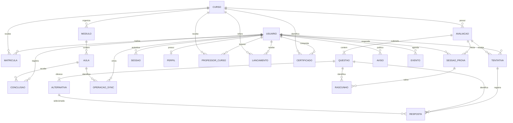

# MER, modelo lógico e modelo físico

## Modelo conceitual (MER)

Um usuário pode possuir perfil pessoal, matrículas e tentativas de avaliação. Professores vinculam-se às disciplinas. Um curso contém módulos e avaliações; um módulo contém aulas. Uma avaliação contém questões e sessões cronometradas; questões não respondidas recebem zero. A conclusão relaciona aluno, aula e ciclo de estudo. Notas/frequências lançadas pela equipe e certificados têm histórico próprio. Sessões de autenticação e operações de sincronização são entidades técnicas; a auditoria registra mudanças sem armazenar credenciais.



O MER descreve as cardinalidades válidas do negócio. A criação transacional pela API impede publicar avaliações vazias e alternativas sem resposta correta. Nem toda cardinalidade mínima de coleção é traduzida em FK: uma FK garante existência do pai, não exige filhos.

## Modelo lógico e dicionário

Schema `saai`. `PK` = chave primária; `FK` = estrangeira; `UQ` = candidata única. Identificadores de negócio são UUIDs; timestamps usam `timestamptz` e os clientes recebem UTC. O PostgreSQL gera UUIDs com `gen_random_uuid()` sem extensão adicional nas versões adotadas.

| Relação              | Atributos principais e chaves                                                                                                                                          |
| -------------------- | ---------------------------------------------------------------------------------------------------------------------------------------------------------------------- |
| users                | **id PK**, name varchar(120), **email UQ** varchar(254), password_hash text, role varchar(16), active bool, token_version int, created_at, updated_at                  |
| courses              | **id PK**, title varchar(160), description varchar(4000), published bool, created_at, updated_at                                                                       |
| modules              | **id PK**, **course_id FK courses**, title varchar(160), position int; **UQ(course_id,position)**                                                                      |
| lessons              | **id PK**, **module_id FK modules**, title varchar(160), content text, position int; **UQ(module_id,position)**, created_at, updated_at                                |
| enrollments          | **id PK**, **user_id FK users**, **course_id FK courses**, enrolled_at; **UQ(user_id,course_id)**                                                                      |
| lesson_progress      | **PK(user_id,lesson_id,learning_cycle)**, FKs users/lessons, completed_at                                                                                              |
| sync_operations      | **PK(user_id,operation_id)**, **lesson_id FK lessons**, processed_at                                                                                                   |
| assessments          | **id PK**, **course_id FK courses**, title varchar(160), created_at                                                                                                    |
| questions            | **id PK**, **assessment_id FK assessments**, prompt varchar(4000), position int; **UQ(assessment_id,position)**                                                        |
| question_options     | **id PK**, **question_id FK questions**, text varchar(2000), is_correct bool; **UQ(question_id,id)**                                                                   |
| attempts             | **id PK**, **user_id FK users**, **assessment_id FK assessments**, operation_id, request_hash char(64), score numeric(5,2), submitted_at; **UQ(user_id,operation_id)** |
| answers              | **PK(attempt_id,question_id)**, FKs attempts/questions, option_id; **FK(question_id,option_id) question_options(question_id,id)**                                      |
| refresh_tokens       | **token_hash PK** char(64), **user_id FK users**, family_id uuid, created_at, expires_at, revoked_at                                                                   |
| audit_log            | **id PK** bigint identity, occurred_at, actor_id uuid, table_name, record_id, action, old_data/new_data jsonb                                                          |
| schema_versions      | **version PK** int, applied_at                                                                                                                                         |
| user_profiles        | **user_id PK/FK users**, **cpf UQ** opcional, phone, address, city, state, postal_code                                                                                 |
| course_teachers      | **PK(course_id,user_id)**, FKs courses/users                                                                                                                           |
| academic_adjustments | **id PK**, FKs user_id/course_id/actor_id, score 0–100, attendance opcional 0–100, reason, created_at                                                                  |
| assessment_sessions  | **id PK**, FKs user_id/assessment_id/attempt_id, started_at, deadline, closed_at, submitted_request_hash; UQ parcial de sessão aberta por aluno/avaliação              |
| assessment_drafts    | **PK(session_id,question_id)**, FKs sessions/questions; FK composta (question_id,option_id)                                                                            |
| announcements        | **id PK**, **author_id FK users**, title, content, created_at                                                                                                          |
| calendar_events      | **id PK**, **author_id FK users**, title, description, starts_at, ends_at, created_at                                                                                  |
| certificates         | **id PK**, FKs user_id/course_id, learning_cycle, student_name, course_title, workload_hours, issued_at; **UQ(user_id,course_id,learning_cycle)**                      |

Extensões das relações iniciais: `users.registration_number` gerado/UQ; `courses.sequential/workload_hours`; `modules.available_from`; `lessons.archived`; `enrollments.learning_cycle`; `sync_operations.learning_cycle`; `assessments.time_limit_minutes/prerequisite_lesson_id FK lessons`; `questions.image_path/image_alt`.

`role` é um domínio fechado por CHECK, sem atributos adicionais dependentes do papel. Não há tabela de papéis com descrições duplicadas. `actor_id` não possui FK propositalmente: a trilha histórica continua válida independentemente da política futura de anonimização de contas. `operation_id` é único por usuário e tipo de operação, não um identificador global entre todos os dispositivos.

## Normalização

- **1FN:** colunas operacionais são atômicas; alternativas e respostas são linhas próprias, não listas de texto. JSONB é utilizado apenas na trilha técnica de auditoria e como parâmetro de procedure, não como substituto das relações.
- **2FN:** atributos de `lesson_progress`, `sync_operations` e `answers` dependem da chave composta completa.
- **3FN:** dados operacionais do usuário/curso/módulo ficam em suas relações próprias. Progresso percentual é calculado pela view, sem duplicação. Certificados guardam snapshots históricos deliberados de nome, título e carga horária para manter a emissão verificável após alterações cadastrais.

`attempts.score` é um resultado histórico da regra de correção, mantido imutável para rastreabilidade. `request_hash` é um fingerprint técnico SHA-256 do pedido canônico para detectar reuso conflitante da chave de idempotência; não duplica o conjunto de respostas. Auditoria é uma projeção histórica deliberada dos registros, separada do modelo operacional normalizado.

## Modelo físico e instalação

O DDL físico integral, com tipos, CHECKs, FKs, índices, views e triggers, é `database/001_schema.sql`. Os demais arquivos completam a instalação:

1. `001_schema.sql`: estrutura e integridade.
2. `002_procedures.sql`: regras críticas e relatórios.
3. `003_seed.sql`: cinco disciplinas, seis aulas e uma avaliação demonstrativa; nenhuma conta ou senha fixa.
4. `004_permissions.sql`: conta de execução com privilégios reduzidos.
5. `005_academic_features.sql`: perfil, vínculos, ciclos, ajustes acadêmicos, avisos, eventos e certificados.
6. `006_timed_assessments.sql`: sessões, rascunhos e prazo de avaliações.
7. `007_original_content.sql`: conteúdo e quiz recuperados do protótipo original.

Com PostgreSQL 16+ e um banco vazio já criado:

```powershell
psql -h localhost -U postgres -d educatech -f database/install.sql
```

`install.sql` é um script do cliente **psql**, com `\ir` para os sete arquivos. Para executar por driver SQL ou ferramenta gráfica em banco vazio, aplique os sete arquivos em ordem. Cada arquivo possui transação. A versão 005 substitui a chave de conclusões e a procedure correspondente, preservando os registros. Não reaplique manualmente em banco existente: `.NET --migrate` consulta `schema_versions` e aplica somente as versões pendentes sob advisory lock.

Depois da instalação, configure LOGIN e senha do papel `educatech_app` por provisionamento seguro. O Compose faz isso na inicialização do PostgreSQL. Um banco local pode usar o comando interativo `\password educatech_app` no psql, seguido de `ALTER ROLE educatech_app LOGIN`. Não utilize a conexão de proprietário na API permanente.

## Procedures e consulta de alto volume

| Objeto                                                                              | Regra / otimização                                                                                              |
| ----------------------------------------------------------------------------------- | --------------------------------------------------------------------------------------------------------------- |
| sp_enroll(user,course)                                                              | Exige aluno ativo e curso publicado; matrícula única; reenvio não duplica                                       |
| sp_complete_lesson(user,lesson,operation,cycle=1)                                   | Confere vínculo, sequência, liberação e ciclo; operação repetida deve ter a mesma aula/ciclo                    |
| sp_submit_assessment(user,assessment,operation,answers,INOUT attempt)               | Lock por aluno, validação integral das relações, uma resposta por questão, correção SQL e idempotência com hash |
| sp_management_report(INOUT result,limit,offset)                                     | Retorna JSONB agregado, página limitada a 100; a API usa 50                                                     |
| fn_management_report(limit,offset)                                                  | Seleciona a página de cursos antes de agregar matrículas/progresso/notas, evitando multiplicação de linhas      |
| v_enrollment_progress                                                               | Calcula total, aulas concluídas e percentual; sem progresso editável pelo cliente                               |
| fn_management_report(user,limit,offset)                                             | Restringe ao escopo do professor antes de paginar/agregar; versão usada pela API                                |
| fn_start_assessment(user,assessment)                                                | Cria/retoma sessão única com prazo do servidor e pré-requisito                                                  |
| sp_submit_timed_assessment(user,assessment,operation,answers,session,INOUT attempt) | Corrige respostas parciais; depois do prazo usa somente rascunhos salvos; preserva idempotência                 |
| sp_restart_course(user,course)                                                      | Avança ciclo, encerra sessões abertas, preserva histórico                                                       |
| try_issue_certificate(user,course)                                                  | Emite snapshot imutável após conclusão e aprovação; acionada por triggers                                       |

Exemplo da interface usada pelo Npgsql (valores sempre parametrizados na aplicação):

```sql
CALL saai.sp_enroll('UUID-ALUNO'::uuid,'UUID-CURSO'::uuid);
CALL saai.sp_complete_lesson('UUID-ALUNO'::uuid,'UUID-AULA'::uuid,'UUID-OPERACAO'::uuid);
CALL saai.sp_management_report(NULL::jsonb,50,0);
-- Uma consulta diagnóstica; execute com dados representativos, fora de horários críticos.
EXPLAIN (ANALYZE, BUFFERS) SELECT * FROM saai.fn_management_report(50,0);
```

Os UUIDs acima são marcadores e devem ser substituídos. Consultas por matrícula usam o índice único `(user_id,course_id)` e o índice inverso por curso. Histórico usa `(user_id,submitted_at DESC)`; alternativas usam FK e índice de uma única correta por questão. Relatório calcula média de **todas** as tentativas, não a melhor tentativa. Cursos sem avaliação têm nota `null`, distinguindo ausência de nota de nota zero. A paginação por OFFSET é suficiente para a base acadêmica; grandes offsets e agregações frequentes devem ser medidos antes de adotar cursor ou visão materializada.

## Triggers, integridade e auditoria

`require_enrollment` verifica o vínculo entre aula e matrícula mesmo em uma inserção SQL direta. `validate_answer_assessment` verifica se a questão pertence à avaliação da tentativa. A FK composta impede escolher alternativa de outra questão. O trigger diferido de alternativas exige de duas a seis opções e uma correta no fechamento da transação.

`touch_updated_at` automatiza timestamps. `audit_change` registra criação/alteração de usuários, cursos, matrículas e conclusões, além de novas tentativas, com actor definido via `set_config(...,true)` dentro da mesma transação. Campos de usuário são reduzidos a id, role e active na auditoria: não há senha, hash, refresh token ou e-mail nessa trilha. Tentativas, respostas e auditoria rejeitam alterações/exclusões por trigger. FKs utilizam RESTRICT para preservar o histórico; usuários são desativados logicamente.

Os triggers complementam FKs; não substituem integridade referencial declarativa. O superusuário de manutenção é uma fronteira de confiança: ele pode administrar o banco. A conta da aplicação não é superusuária e não pode desativar triggers ou truncar tabelas.

A versão 005 audita também vínculos de professores, atividades, lançamentos, avisos e eventos. Ajustes e certificados rejeitam alterações/exclusões; a conta de runtime só consulta certificados e a emissão é feita por função com `SECURITY DEFINER` e `search_path` fixo. Dados de contato/CPF não são copiados à auditoria. Arquivamento não apaga conclusões de atividades removidas da apresentação.
