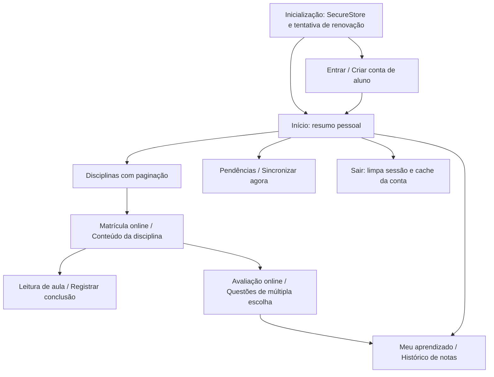

# Aplicativo Mobile

React Native com Expo consome a mesma API .NET e os mesmos modelos de negócio do Web. Essa escolha mantém desenvolvimento Android/iOS com TypeScript e dispensa o workload MAUI ausente nesta máquina. O manual não determina framework Mobile; exige telas, navegação, autenticação, sincronização e integração por APIs, presentes no projeto.

## Executar

```powershell
Set-Location mobile
Copy-Item .env.example .env
# Edite EXPO_PUBLIC_API_URL para a API acessível pelo dispositivo.
npm ci
npm run android
```

Use `https://seu-host/api/v1` em produção. `EXPO_PUBLIC_API_URL` é configuração pública, não um segredo. Android Emulator acessa o host por `10.0.2.2`; um celular físico precisa de host/IP alcançável. O Compose publica somente em loopback para desenvolvimento Web: para acesso físico, configure uma entrada HTTPS alcançável e inclua seu host em `AllowedHosts`. Não desative validação de certificado. HTTP só é aceito pelo código em desenvolvimento; a plataforma nativa pode exigir configuração adicional para tráfego claro. Prefira HTTPS com certificado confiável.

Para a demonstração Android no PC, configure `.env` com `EXPO_PUBLIC_API_URL=http://10.0.2.2:5080/api/v1`, mantenha a Web/API rodando com `npm --prefix tooling run dev` em outro terminal e abra o emulador antes de executar o comando acima. Para compilar binários nativos, instale Android SDK/JDK ou Xcode no ambiente adequado e execute `npm run android` ou `npm run ios`. iOS requer macOS para compilação local. `expo export --platform android` gera bundle JavaScript/Hermes, **não um APK**. Não foi instalado SDK Android, emulador, Xcode ou conta de publicação durante esta entrega.

## Telas e navegação



O estado de navegação é tipado pela união `Screen` em `App.tsx`. Fluxos de conteúdo retornam ao início por controle visível. A administração completa acontece no Web; equipe pode consultar conteúdo pelo Mobile, mas apenas Student envia respostas e conclusões.

## Sessão e armazenamento

`src/api.ts` centraliza URL, JSON, erros, JWT e renovação. A sessão inteira fica em uma chave versionada do SecureStore, protegida pelo armazenamento de credenciais da plataforma. A senha digitada é removida do estado após login/cadastro. Um refresh token renovado substitui o anterior; falhas 401 na renovação removem a sessão local. Falha de rede permite consultar o cache previamente baixado, sem conceder autorização no servidor.

Access tokens duram dez minutos por padrão. Requisições concorrentes compartilham uma única promessa de renovação. Uma resposta que chega após troca de conta é rejeitada para não contaminar o cache do outro usuário.

`src/storage.ts` usa AsyncStorage para cache de disciplinas, aulas, matrículas e tentativas, separado por UUID de usuário e versão. Esse cache não guarda senhas/tokens e não oferece a mesma proteção criptográfica do SecureStore. Na saída normal sem pendências, o cache daquela conta é removido. Dados já baixados podem permanecer em dispositivos offline mesmo após uma revogação remota, até a próxima comunicação; operações no servidor continuam exigindo sessão válida.

## Sincronização

Conclusões são monotônicas dentro de cada ciclo de estudo. O cliente não envia percentual, nota, timestamp de conclusão ou usuário. Cada operação contém UUID, identificador da aula e `learningCycle` recebido do servidor. O servidor define hora, matrícula, sequência e liberação. Reiniciar na Web incrementa o ciclo; pendências antigas são rejeitadas, sem contaminar o novo progresso.

1. Ao concluir uma aula, a operação é persistida antes do feedback local.
2. A mesma aula não é enfileirada duas vezes no mesmo ciclo.
3. O aplicativo envia lotes de até 100 para `/sync`.
4. Apenas IDs confirmados com `success: true` são removidos, lendo novamente a fila sob lock. Operações criadas durante a chamada permanecem.
5. Falhas de rede, autorização ou conflito preservam as pendências; a tela informa o erro e permite tentar novamente.
6. A sincronização ocorre com o app aberto, a cada 30 segundos, ao retornar ao primeiro plano ou por comando manual.

O aplicativo impede a saída normal enquanto existem conclusões pendentes, explicando a necessidade de sincronizar. Não há serviço de background garantido pelo sistema operacional. A fila tem limite de mil operações. Falhas permanentes exigem corrigir acesso/matrícula ou análise administrativa; não há descarte silencioso automático.

Matrículas e avaliações exigem conexão. Respostas não ficam em fila offline. A avaliação cria/retoma sessão de prazo definido no servidor e salva cada seleção como rascunho online; abrir novamente restaura as respostas confirmadas. A tela mostra cronômetro, bloqueia novas escolhas no prazo encerrado e permite enviar os rascunhos. O servidor recusa mudanças tardias. Se o envio sofre timeout, a tela preserva identificadores/respostas para reenvio idempotente. Imagens de questões são carregadas da mesma origem da API.

O download de dados é um snapshot atualizado por consulta, com paginação no catálogo. `serverTime` documenta o instante do servidor, mas não há protocolo de delta por cursor nem tombstones. Eles não são necessários porque o cliente sincroniza apenas conclusões monotônicas e a API não expõe exclusão física desses dados.

## Validação e acessibilidade

O TypeScript usa modo estrito. Os testes em `tooling/tests/unit/sync.test.mjs` verificam deduplicação e confirmação parcial com operações concorrentes. O código foi exportado em bundle Android. Isso não substitui teste em dispositivo: executar login, reiniciar app, operar em modo avião após carregar aulas, reconectar, verificar isolamento entre contas e testar TalkBack/VoiceOver antes de uma distribuição.

Controles têm nomes acessíveis, estados de radio/disabled e alvos de toque de ao menos 48 unidades nos botões. Texto utiliza o escalonamento padrão do sistema. A tela de convivência no Web e o cartão no Mobile explicitam respeito à diversidade e encaminhamento de barreiras à coordenação. Os recursos não constituem uma certificação formal de acessibilidade.
