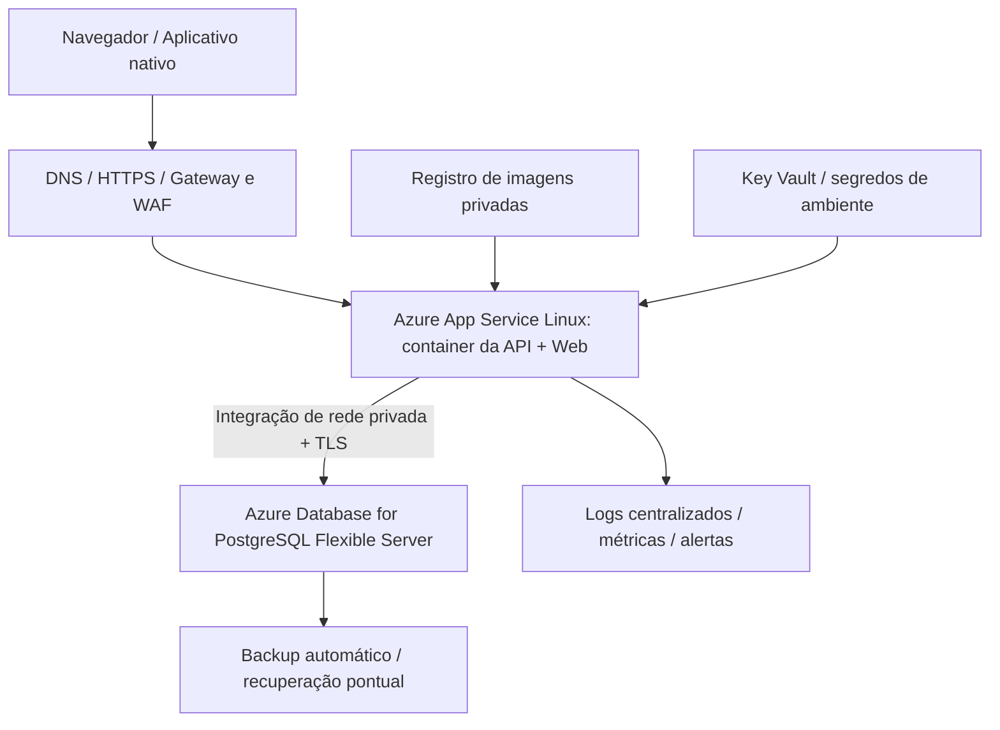

# Infraestrutura em nuvem e DevOps

## Entregas e ambiente

O repositório fornece `infra/docker/Dockerfile` de múltiplos estágios, `infra/docker/compose.yaml` com banco persistente, `infra/postgres/init.sh` para a conta SQL de execução e pipeline de validação em `.github/workflows/ci.yml`. O contexto de build é a raiz do repositório; a exclusão de arquivos está em `infra/docker/Dockerfile.dockerignore`. Para build manual, execute `docker build -f infra/docker/Dockerfile -t educatech:local .`. O plano abaixo cobre a etapa 8 do manual. Nenhum recurso de nuvem foi criado e nenhum código foi publicado nesta tarefa.

O manual chama nuvem e DevOps de diferenciais nos objetivos específicos, mas exige expressamente um plano para arquitetura, serviços, containers, CI/CD, monitoramento, escalabilidade e segurança. Esses itens são tratados como parte obrigatória da documentação; não se afirma que uma implantação em conta de nuvem foi realizada.

## Topologia proposta



Serviços podem ser substituídos por equivalentes de outro provedor. App Service foi escolhido para reduzir administração de servidores; a documentação oficial apresenta sua arquitetura básica e recomendações operacionais. PostgreSQL gerenciado mantém compatibilidade com os scripts. Não há requisito de Kubernetes para este volume acadêmico.

## Plano de execução

1. Definir região, orçamento máximo, responsáveis e ambientes separados de homologação/produção. Registrar nomes, domínio, configuração de rede e política de retenção.
2. Criar PostgreSQL 16+ gerenciado com acesso privado, backup e usuário proprietário exclusivo da rotina de migração. Criar banco e papel de runtime. Medir requisitos de armazenamento a partir de testes, não de números hipotéticos tratados como demanda real.
3. Executar os arquivos de instalação ou o comando de migração em um job com conectividade privada. Configurar senha da conta de runtime por Secret Manager; o bootstrap usa variável temporária e não deve ficar na configuração permanente do serviço.
4. Construir imagem a partir do commit validado, publicar em registro autorizado e usar tag imutável ou digest. Executar container como usuário `app`, sem acesso administrativo ao host.
5. Configurar `ASPNETCORE_ENVIRONMENT=Production`, `ConnectionStrings__Database` com usuário `educatech_app` e `SSL Mode=VerifyFull`, JWT, `AllowedHosts` com o domínio real e proxy confiável em `ReverseProxy__KnownProxy` quando aplicável. Configurar HTTPS no ingresso e cadeia de certificado confiável. Não aceitar cabeçalhos forwarded de origens arbitrárias.
6. Habilitar sondas de saúde. `/health/live` verifica processo; `/health/ready` verifica acesso ao banco e schema. O provedor deve reconhecer o esquema HTTPS original e permitir as sondas internas de acordo com sua configuração de ingresso. Não usar readiness como liveness, pois uma indisponibilidade temporária do banco não deve reiniciar todos os processos.
7. Testar login, permissões, matrícula, sincronização e avaliação em homologação, com a imagem candidata. Verificar cookie Secure e ausência do Swagger público.
8. Promover por slot/revisão quando as verificações passarem, observar métricas e só então direcionar todo o tráfego. Se houver erro funcional, voltar à imagem anterior compatível com o schema atual.

`DatabaseSetup` executa migrações com advisory lock e versões incrementais. As versões 001–004 fazem a instalação inicial; 005–007 acrescentam os recursos restaurados, preservando os dados anteriores. A chave de conclusões passa a incluir o ciclo de estudo; a aplicação deve ser atualizada junto com essas migrações. Faça backup e pare a versão anterior antes dessa atualização. Não há rollback destrutivo automático. Nunca reaplique o DDL inicial sobre um banco existente.

## CI/CD

`.github/workflows/ci.yml` já define a integração contínua: restore/build .NET, testes da fila, PostgreSQL real, testes de API/navegador, validação TypeScript, exportação Android e build da imagem. O runner não recebe segredos de produção. A pipeline usa uma base temporária de teste e não executa migrações em contas externas.

O trecho de entrega contínua deve ser conectado ao ambiente escolhido pelo grupo:

```text
PR -> build + testes + imagem
   -> imagem imutável no registro
   -> job de migração em homologação
   -> implantação em slot de homologação
   -> smoke test e validação de acessibilidade
   -> promoção para produção no ambiente protegido
   -> observação e eventual retorno à imagem anterior
```

Use identidade federada/OIDC do provedor para o runner; segredos não devem ser gravados em YAML. Autorizações e variáveis de uma conta real dependem do ambiente do grupo. Assim, há CI implementada e **plano de CD**, sem alegação de deploy automatizado em nuvem já executado.

## Monitoramento e escala

Coletar taxa de erro HTTP, latência p50/p95, requisições em andamento, CPU/memória, utilização do pool Npgsql, conexões e locks do PostgreSQL, consultas lentas, falhas de login e atraso das operações de sincronização. Definir alertas após medir um baseline; uma meta inicial proposta é investigar erro 5xx persistente e p95 acima de dois segundos, sem apresentar isso como SLA contratado.

Escalar inicialmente a aplicação por réplicas; todas usam o mesmo banco e mesma configuração JWT. A sessão não depende de memória do servidor. Configure limite de pool por réplica: `número de réplicas × Maximum Pool Size` precisa respeitar o limite de conexões do banco. A chave JWT deve ser compartilhada via Secret Manager. Rate limiting no processo é por réplica: um gateway deve aplicar limites globais, incluindo proteção contra tentativas distribuídas de login.

O Web é estático e servido junto da API. A separação para CDN exige rever CSP, CORS e a estratégia de autenticação; não basta copiar o HTML para outro domínio. Não há uploads ou armazenamento de arquivos no contêiner. Refresh tokens são persistidos no PostgreSQL e as requisições de escrita usam transações curtas.

## Backup, manutenção e segurança

Proposta acadêmica de recuperação: definir RPO de até 24 horas e RTO de até quatro horas, validar a viabilidade com o plano contratado e testar uma restauração em base isolada. A recuperação pontual gerenciada pode permitir objetivos melhores, que dependem de configuração e serviço. Backups sem teste de restauração não comprovam recuperabilidade.

Definir retenção para auditoria, contas desativadas e famílias de refresh expiradas, considerando obrigações da instituição. Não apagar tokens revogados ainda dentro de sua janela de validade: a detecção de replay depende deles. Limpeza de histórico acadêmico/auditoria demanda um procedimento de manutenção autorizado porque os triggers impedem exclusão comum.

Atualizar imagens e pacotes, manter a versão do runtime suportada, executar análise de dependências na esteira e testar restauração/rotação de segredos. A troca da chave JWT atual invalida tokens existentes; a implementação possui uma chave ativa, sem rotação por `kid`. Em produção com exigência de continuidade, evoluir para chave assimétrica e conjunto de chaves versionado.

## Evidência e limite

O backend e SQL foram executados localmente com .NET e PostgreSQL real. Docker/CLI Azure não estão instalados neste ambiente; a imagem, o Compose e o workflow foram preparados, mas não executados aqui. O teste integrado cobre a conta de banco com permissões reduzidas. O bundle Mobile foi exportado; distribuição em loja e instalação em aparelho não foram realizadas.
